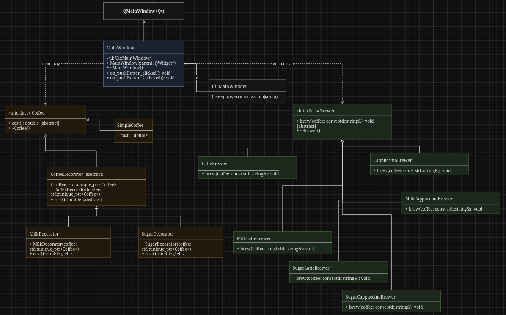
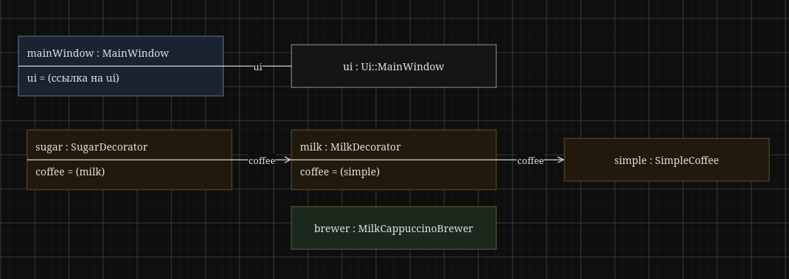

## Шаблон проектирования «Декоратор» на примере кофейного заказа

Кофе как базовый напиток с помощью декораторов получает дополнительные ингредиенты (молоко, сахар), и каждый ингредиент меняет стоимость. Код состоит из трёх частей: Qt-окно MainWindow, иерархия кофе и декораторов, иерархия заваривателей Brewer. В конце файла находится классический пример декоратора без Qt с классами Component и Decorator.

**MainWindow** — главное окно, обработчики нажатий двух кнопок; наследует QMainWindow, хранит ui, создаёт заваривателей и кофе.

**Coffee** — абстрактный интерфейс напитка с методом cost(), базовый тип для всех напитков и декораторов.

**SimpleCoffee** — базовый напиток стоимостью 1.0, реализует Coffee.

**CoffeeDecorator** — абстрактный декоратор; хранит обёрнутый напиток в unique_ptr, реализует/содержит Coffee.

**MilkDecorator** — добавляет молоко, +0.5 к стоимости; наследует CoffeeDecorator.

**SugarDecorator** — добавляет сахар, +0.2 к стоимости; наследует CoffeeDecorator.

**Brewer** — интерфейс заваривания brew(const std::string&), базовый тип для шести заваривателей.

**LatteBrewer, CappuccinoBrewer** — выводят название напитка и строку заказа, наследуют Brewer.

**SugarLatteBrewer, SugarCappuccinoBrewer** — выводят дополнительную строку о сахаре и название напитка, наследуют Brewer.

**Интерфейс Coffee** задаёт единственный метод cost(). Конкретный напиток SimpleCoffee возвращает базовую стоимость 1,0. Абстрактный CoffeeDecorator — сам Coffee и хранит другой Coffee в поле coffee типа std::unique_ptr<Coffee>. Благодаря этому декоратор может обернуть любой объект интерфейса, в том числе другой декоратор.

**Конкретные декораторы** переопределяют cost() так: сначала запрашивают стоимость обёрнутого напитка, затем прибавляют свою надбавку. Обработчик последовательно строит цепочку и выводит стоимость на каждом шаге. Стоимость при этом вычисляется рекурсивно: вызов cost() у внешнего декоратора обращается к внутреннему, пока не дойдёт до SimpleCoffee, после чего надбавки складываются обратно. Переменная coffee при каждом шаге получает новый объект, а предыдущий передаётся внутрь через std::move; поэтому владение переходит к новому декоратору и утечек памяти нет.

**Заваривание напитков**. Класс Brewer определяет метод brew, принимающий строку с описанием заказа. Обработчик on_pushButton_clicked() создаёт шесть заваривателей через std::make_unique и вызывает brew у каждого. Заваривание не использует стоимость и не связано с декораторами: это отдельная подсистема, лишь демонстрирующая полиморфизм через интерфейс.

**Главное окно MainWindow**. Конструктор вызывает ui->setupUi(this), создающий элементы интерфейса из файла формы. Деструктор удаляет ui. Обработчики on_pushButton_clicked() и on_pushButton_2_clicked() подключаются автоматически по соглашению именования, использующего uic: имя слота образуется из имени объекта и сигнала. Вывод в ui->textBrowser выполняется через insertPlainText.

*Классы Component, ConcreteComponent, Decorator, ConcreteDecoratorA и ConcreteDecoratorB* повторяют структуру из каталога шаблонов проектирования. Метод Operation() в декораторах по умолчанию делегирует вызов обёрнутому компоненту, а конкретные декораторы изменяют результат: ConcreteDecoratorA добавляет префикс, ConcreteDecoratorB тоже оборачивает результат. В main() строится цепочка ConcreteDecoratorB(ConcreteDecoratorA(ConcreteComponent)), а клиентский код ClientCode работает только с базовым типом Component.

## Ценность шаблона «Декоратор»

**Расширение без изменения существующего кода**. Чтобы добавить сливки, достаточно написать класс CreamDecorator, который наследует CoffeeDecorator и переопределяет cost(). Классы Coffee, MilkDecorator, SugarDecorator и обработчики меняться не должны. Это соответствует принципу открытости/закрытости: модуль открыт для расширения и закрыт для модификации.

**Комбинации без взрыва числа классов**. Если пытаться выразить все сочетания добавок через наследование, число классов растёт экспоненциально. Декораторы можно комбинировать в любом порядке и количестве, создавая нужную конфигурацию во время выполнения.

**Композиция во время выполнения**. Состав напитка определяется в момент создания объекта, а не написания кода. В обработчике кнопки цепочка строится последовательными присваиваниями переменной coffee. Тот же приём позволяет по данным заказа из базы или пользовательского ввода собирать произвольную комбинацию.

**Единственная ответственность**. Каждый декоратор отвечает за одну добавку, а SimpleCoffee — за базовую стоимость. Логика цены не смешивается с логикой ингредиентов, а тестировать каждый класс можно отдельно.

**Прозрачность для клиента**. Клиентский код работает через интерфейс Coffee и не знает, сколько декораторов обёрнуто. Для MainWindow цепочка из трёх объектов выглядит так же, как один напиток; поэтому добавление новых уровней не затрагивает вызывающую сторону.

*Цена шаблона*. У декоратора есть и недостатки. Цепочка из нескольких объектов сложнее отлаживать: в отладчике видно несколько вложенных обёрток вместо одного объекта. Порядок декораторов иногда важен, и при неудачной последовательности поведение может отличаться. Каждый декоратор создаёт отдельный объект в куче, что при большом числе декораторов и частом создании заметно по производительности. Наконец, декоратор не меняет идентичность: dynamic_cast к конкретному типу напитка может не сработать, если тип скрыт внутри цепочки.

## Диаграммы классов и объектов

