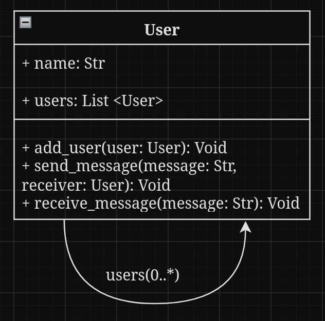
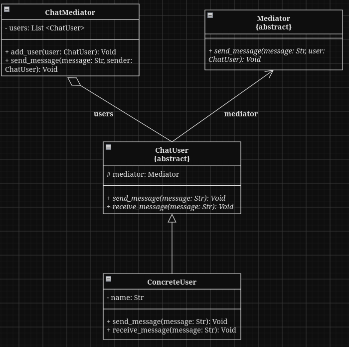

В реализации чат-системы, где пользователи отправляют друг другу сообщения, без централизованного управления (не с таким паттерном, как посредник) каждый из них (User) напрямую взаимодействует с другими, что делает систему сложнее для расширения и менее гибкой.

Класс User вызывает при отправке сообщения (send_message) метод receive_message напрямую на целевом пользователе (у получателя).
Каждый пользователь (User) хранит список других (users) для возможного взаимодействия.

Недостатки
* Сильная связанность: каждый пользователь должен знать о существовании других пользователей и напрямую взаимодействовать с ними.
* Сложность добавления новых пользователей: чтобы добавить нового пользователя, нужно обновить все существующие объекты User.
* Трудности с поддержкой: если логика взаимодействия изменится, придётся обновлять код во всех классах User.

Это может быть приемлемо в небольших системах с фиксированным набором взаимодействующих объектов, если взаимодействие между ними проходит по строго заданным правилам и не требует динамического изменения.

*Диаграмма классов на UML*:

Паттерн Посредник (Mediator) полезен в архитектурах, где взаимодействие между объектами становится сложным и запутанным, позволяя уменьшить количество прямых связей между компонентами системы, централизуя управление взаимодействиями. Отправка сообщения от одного пользователя другому идёт через посредника — это решает проблему прямой зависимости между объектами: централизованный объект (чат-сервер) управляет всеми взаимодействиями между пользователями.

Структура классов: User, MediatorManager, ChatMediator, ChatUser.

MediatorManage координирует взаимодействие между User-объектами.

ChatMediator — посредник, управляющий всеми взаимодействиями между пользователями (ChatUser), хранящий их список и отправляющий сообщения от одного к остальным.

ConcreteUser — это конкретный пользователь (может отправлять/получать сообщения); при отправке он передаёт его посреднику, затем распространяющего это среди других.

Преимущества
* Уменьшение связанности: пользователи не знают друг о друге напрямую, взаимодействуя только с посредником.
* Централизация логики взаимодействия: управление сосредоточено в посреднике.

**Вывод**: шаблон полезен в системах с большим числом взаимодействующих объектов, когда необходимо уменьшить связанность между этими компонентами, а логика между ними становится слишком сложной и требует централизации.
