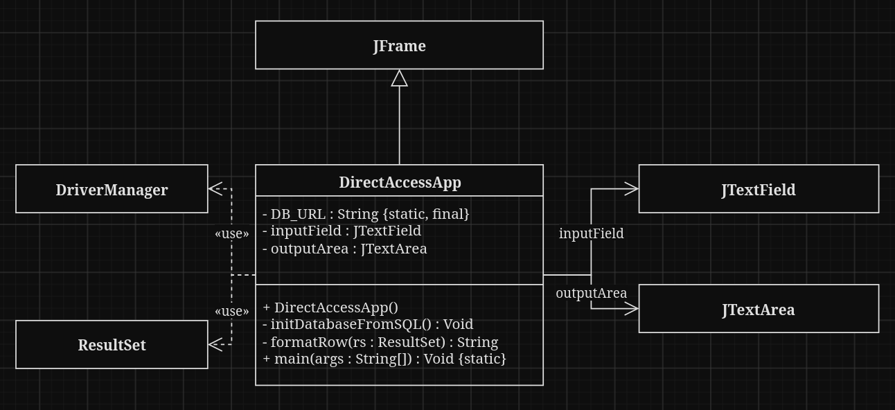
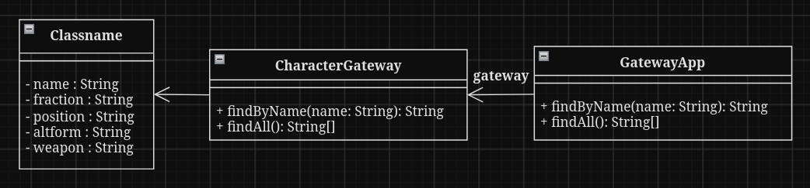

## Предметная область
Система вопрос-ответ по видеоигре. Приложение предназначено для поиска характеристик персонажей (имя, сложность, роль, Прайм-форма, показатели) на основе данных, хранящихся в реляционной БД.

## Недостатки
В прямой реализации взаимодействия между пользовательским интерфейсом и источником данных возникают следующие проблемы:
1. Громоздкий код: для работы с БД нужны SQL-запросы, обработка результатов и управление соединениями.
2. Нарушение принципа разделения ответственности: код, отвечающий за отображение информации пользователю, будет зависеть от того, как устроена база данных (сущности, признаки).
3. Риски при внесении изменений в систему: если потребуется изменить БД или подключить внешний API, понадобится масштабный рефакторинг всех модулей, обращающихся к данным.

## Решение
Применён архитектурный паттерн проектирования «Шлюз». В системе реализован класс CharacterGateway, выступающий единой точкой входа для инкапсуляции доступа к источнику данных. 

## Запуск
1. Установить JDBC-драйвер для SQLite в папку с программным кодом: https://github.com/xerial/sqlite-jdbc/releases
2. В соответствующих каталогах запустить через терминал команды:
- javac -cp .:sqlite-jdbc-3.53.1.0.jar *.java
- java -cp .:sqlite-jdbc-3.53.1.0.jar DirectAccessApp
- java -cp .:sqlite-jdbc-3.53.1.0.jar Main

*Диаграммы классов на UML*:

## Вывод
При реализации системы без паттерна графический интерфейс напрямую управлял JDBC-соединениями, содержал SQL-запросы и логику парсинга ResultSet, что привело к высокой связности между слоем представления и источником данных и к нарушению принципа единственной ответственности. Архитектурный паттерн **Шлюз** устранил эти недостатки: клиентский модуль GatewayApp теперь взаимодействует с системой исключительно через удобный интерфейс, не содержа ни одной строки кода, связанного с БД.
